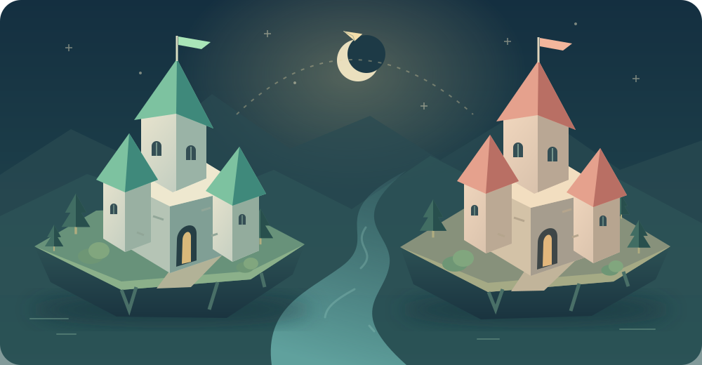

# 🏰 Les Deux Bastions

### 🧠 Des idées. 🤝 Des alliés. 🛡️ Un bastion.

**Un jeu de quiz et de stratégie pour faire équipe !** Deux équipes s’affrontent depuis leurs téléphones : répondez ensemble à des questions de culture générale, gagnez des pièces et choisissez comment attaquer le village adverse ou protéger le vôtre.



## 🎯 Le but du jeu

**Détruire le bastion adverse avant que le vôtre ne tombe à zéro point de vie.**

Chaque équipe commence avec **120 points de vie ❤️** et **12 pièces 🪙**. Toutes les **30 secondes ⏱️**, les deux équipes reçoivent la même question aléatoire. Vous disposez de **25 secondes** pour discuter et valider une seule réponse.

- ✅ Bonne réponse : **+12 pièces**.
- ❌ Mauvaise réponse ou absence de réponse : aucun gain, aucune pénalité.
- 📦 Nouvelle manche : **+3 pièces** de ravitaillement.
- ⚔️ Dépensez vos pièces pour attaquer, vous protéger ou réparer votre village.
- 🏆 La dernière équipe dont le village tient debout remporte la partie ! Une destruction simultanée donne une égalité.

Les projectiles mettent **4 à 7 secondes** à arriver : surveillez les attaques et défendez-vous à temps. Les achats restent possibles pendant le quiz.

## 🤝 Un jeu pensé pour le team building

- 👥 **Deux équipes**, avec **un téléphone par équipe**.
- 💬 Les joueurs discutent des réponses et prennent leurs décisions ensemble.
- 🔄 Changez de porte-parole toutes les deux questions pour faire participer chacun.
- ⏳ Comptez environ **3 à 9 minutes** de jeu, puis un court débrief.
- 💡 Après la partie : « Quelle idée d’un coéquipier a changé notre stratégie ? »

Le projet est réalisé dans le cadre d’un **cours utilisant la méthode Agile avec Scrum**. Les documents de démarrage et de suivi sont disponibles dans le dossier [`docs/`](docs/README.md).

## ✨ Ce que contient le jeu

- 🏕️ Création d’une partie et invitation par code de six caractères.
- 📚 **72 questions** dans six thèmes de culture générale.
- ⚔️ **Quatre attaques** et 🛡️ **trois défenses**.
- 🎨 Villages illustrés, projectiles animés, boucliers et journal de bataille.
- 📱 Interface adaptée aux téléphones et aux ordinateurs.
- 🔁 Reconnexion après rechargement et revanche avec l’accord des deux équipes.
- 🤖 Mode **« Explorer une démo »** contre une équipe automatique.
- 🔊 Sons facultatifs, activables dans l’interface.

## 💻 Avant de commencer

Il vous faut :

- Un ordinateur **Windows, macOS ou Linux** pour héberger la partie.
- **[Node.js](https://nodejs.org/) version 20 ou supérieure**, installé sur cet ordinateur. Vérifiez avec `node --version`.
- Deux téléphones avec un navigateur.
- L’ordinateur et les téléphones connectés au **même réseau Wi-Fi**, autorisant les échanges entre appareils.

📦 Le projet n’utilise **aucune dépendance externe à installer** : pas besoin de `npm install`.

🌐 Une fois Node.js et le projet téléchargés, le jeu fonctionne sur le réseau local sans accès Internet. Aucun compte joueur n’est nécessaire.

## 🚀 Installer et lancer le jeu

### 1️⃣ Récupérer le projet

**Avec Git :**

```bash
git clone https://github.com/loictlmd/LesDeuxBastions.git
cd LesDeuxBastions
```

**Sans Git :** cliquez sur **Code → Download ZIP** sur GitHub, décompressez l’archive, puis ouvrez un terminal dans le dossier extrait contenant `package.json`.

### 2️⃣ Démarrer le serveur

Sur **Windows, macOS et Linux**, lancez :

```bash
npm start
```

Ou directement :

```bash
node server.mjs
```

Vous verrez des adresses de ce type dans le terminal :

```text
LES DEUX BASTIONS
Sur cet ordinateur : http://localhost:3000
Sur les téléphones (même Wi-Fi) : http://192.168.1.42:3000
```

⚠️ L’adresse `192.168.1.42` est un **exemple**. Utilisez celle réellement affichée sur votre ordinateur.

### 🍎 Raccourci sur Mac

Depuis le dossier du projet :

```bash
zsh "Lancer le jeu.command"
```

Le lanceur ouvre le navigateur automatiquement. Pour pouvoir ensuite le lancer par un double-clic dans le Finder, rendez-le exécutable une première fois :

```bash
chmod +x "Lancer le jeu.command"
```

### 🪟 Raccourci sur Windows

Double-cliquez sur **`Lancer le jeu.bat`** après avoir installé Node.js. Le navigateur s’ouvre automatiquement.

### 🐧 Sur Linux

Utilisez `npm start`, puis ouvrez [http://localhost:3000](http://localhost:3000) sur l’ordinateur.

## 📱 Connecter les deux équipes

1. 📶 Connectez les deux téléphones au **même Wi-Fi que l’ordinateur**.
2. 🌐 Ouvrez sur chaque téléphone l’adresse **« Sur les téléphones »** affichée dans le terminal.
3. 🏕️ **Équipe A** : saisissez votre nom et choisissez **Créer une partie**.
4. 🔑 **Équipe B** : choisissez **Rejoindre** et entrez le code partagé par l’équipe A. Le lien d’invitation fonctionne aussi.
5. ✅ Chaque équipe appuie sur **Nous sommes prêts**.
6. 🚩 L’équipe qui a créé le camp appuie sur **Lancer la bataille**.
7. 🏆 Jouez jusqu’au résultat, puis proposez une revanche !

> 💡 Sur un téléphone, n’utilisez pas `localhost` : cela désigne le téléphone lui-même, pas l’ordinateur qui héberge la partie.

> 🔌 Gardez l’ordinateur allumé, sans veille, et la fenêtre du serveur ouverte. Gardez aussi les téléphones déverrouillés. Pour arrêter le serveur, appuyez sur **Ctrl+C**. L’arrêt efface les parties en cours, conservées en mémoire.

### 🤖 Découvrir le jeu seul

Ouvrez [http://localhost:3000](http://localhost:3000), puis cliquez sur **Explorer une démo**. Confirmez que votre équipe est prête et lancez la bataille contre les Veilleurs, une équipe automatique.

Pour essayer le mode deux équipes sur un seul ordinateur, ouvrez le jeu dans deux nouveaux onglets distincts. Chaque onglet conserve sa propre équipe.

## ⚔️ Attaques et défenses

| Équipement | Prix 🪙 | Effet normal | Impact / recharge |
|---|---:|---|---|
| 🏹 Volée de flèches | 8 | 12 dégâts | 4 s / 4 s |
| 🪨 Catapulte | 18 | 32 dégâts | 7 s / 7 s |
| ⚡ Éclair perçant | 14 | 18 dégâts qui ignorent le bouclier | 6 s / 6 s |
| 🧨 Sabotage | 10 | Retire jusqu’à 24 de bouclier, puis inflige 6 dégâts ordinaires | 5 s / 5 s |
| 🛡️ Dôme protecteur | 10 | +18 de bouclier, maximum 36 ; dure 45 s | Immédiat / 8 s |
| 🔧 Atelier de réparation | 14 | +16 PV, maximum 120 | Immédiat / 20 s |
| 🪞 Miroir de riposte | 12 | Bloque et renvoie 40 % de la prochaine attaque ; expire après 12 s | Immédiat / 20 s |

⏱️ Deux achats doivent être espacés d’au moins **2 secondes**. Chaque équipement a également sa propre recharge.

🪞 Le renvoi du miroir est arrondi à l’entier le plus proche. Il peut être absorbé par le bouclier adverse et ne déclenche pas de deuxième miroir. Un sabotage retire le bouclier avant la réduction des dégâts par le miroir.

🛡️ Un second dôme ajoute des points jusqu’au plafond de 36 et renouvelle la protection pour 45 secondes.

### 🌩️ Une fin de partie garantie

- À **4 minutes**, le siège commence : les nouvelles attaques infligent **50 % de dégâts supplémentaires**.
- À **6 minutes**, les réparations ferment et une tempête se prépare.
- Dès **6 min 10 s**, puis toutes les 10 secondes, chaque village perd **8 PV**, même à travers les boucliers.
- Si le serveur reste actif, la partie finit au plus tard à **8 min 30 s**.

## 🛠️ Un problème de connexion ?

| Problème | Solution |
|---|---|
| Le téléphone n’ouvre pas le jeu | Vérifiez le Wi-Fi commun et utilisez l’adresse IP affichée, avec son port. |
| Le réseau de l’école ou de l’entreprise bloque la connexion | Certains réseaux isolent les appareils. Testez avant le cours et utilisez un réseau autorisant les échanges locaux. |
| Le système demande une autorisation réseau | Autorisez Node.js à recevoir les connexions sur votre réseau local. |
| Le port 3000 est déjà utilisé | Fermez l’ancienne instance ou choisissez un autre port ci-dessous. |
| La page a été rechargée | Le même onglet retrouve son équipe. Les ressources restent gérées par le serveur. |
| Le Wi-Fi a brièvement coupé | Le jeu essaie de se reconnecter automatiquement. Le chronomètre continue. |
| Une équipe disparaît | Après 90 secondes d’absence, l’équipe encore connectée peut gagner par forfait. |
| Le serveur a été arrêté | Relancez-le et créez une nouvelle partie. Les anciennes parties ne sont pas sauvegardées. |

Pour utiliser le port 3001 :

**macOS / Linux :**

```bash
PORT=3001 node server.mjs
```

**Windows PowerShell :**

```powershell
$env:PORT = "3001"
node server.mjs
```

Utilisez alors l’adresse avec `:3001` sur les téléphones.

## 🧪 Tests et équilibrage

```bash
npm test
npm run simulate
```

- ✅ **17 tests automatisés** du moteur et du protocole HTTP passent.
- 📱 Un parcours complet a été vérifié dans deux sessions Chromium avec des écrans mobiles simulés.
- 🎲 **500 matchs simulés** ont été utilisés pour étudier les stratégies et vérifier que les parties se terminent.
- 👥 L’équilibrage est une première base : il reste à l’affiner avec les joueurs et à tester sur les vrais téléphones et le Wi-Fi du cours.

Le détail des vérifications et le protocole de recette sont dans [Tests et équilibrage](docs/04_TESTS_ET_EQUILIBRAGE.md).

## 📂 Organisation du projet

```text
LesDeuxBastions/
├── server.mjs                  # Serveur HTTP et API multijoueur
├── src/
│   ├── game.mjs                # Moteur de partie et règles
│   ├── catalog.mjs             # Équipements, prix et délais
│   └── questions.mjs           # Questions et solutions côté serveur
├── public/
│   ├── index.html             # Interface du jeu
│   ├── app.js                 # Interactions et synchronisation
│   ├── style.css              # Affichage ordinateur et mobile
│   └── assets/                # Illustrations SVG originales
├── test/                      # Tests automatisés
├── scripts/simulate.mjs        # Simulations d’équilibrage
├── docs/                      # Documents Scrum et recette
├── Lancer le jeu.command      # Lanceur macOS
├── Lancer le jeu.bat          # Lanceur Windows
└── package.json
```

## 📋 Le projet Agile / Scrum

- 🚩 [Fiche de démarrage](docs/01_DEMARRAGE.md)
- 📝 [Product Backlog et critères d’acceptation](docs/02_BACKLOG.md)
- 🏃 [Fiches de sprint, suivi, review et rétrospective](docs/03_SPRINTS.md)
- 🧪 [Tests, équilibrage et recette](docs/04_TESTS_ET_EQUILIBRAGE.md)

Les noms, dates et décisions du groupe sont à compléter avec vos informations réelles. Le prototype disponible n’est pas présenté comme un sprint déjà réalisé par le groupe.

## 🌐 Hébergement

Cette version tourne **sur l’ordinateur de l’animateur**, avec un seul serveur Node.js. Les téléphones interrogent ce serveur toutes les 800 ms ; il contrôle les réponses, les pièces et les dégâts.

**GitHub héberge le code, pas la partie.** GitHub Pages seul ne peut pas exécuter ce serveur Node.js. Pour jouer depuis des réseaux différents, il faudra prévoir un hébergement capable de faire tourner un processus Node.js ; aucun déploiement Internet n’est configuré dans cette version.

---

**🏰 Culture commune. 🤝 Esprit d’équipe.**
